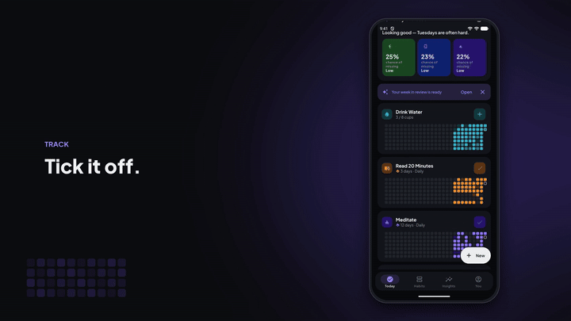
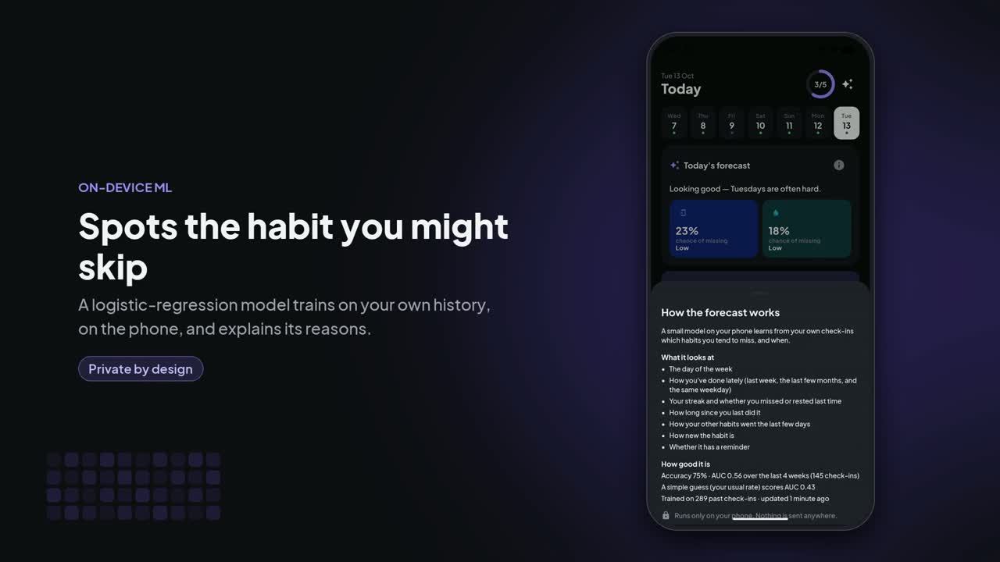
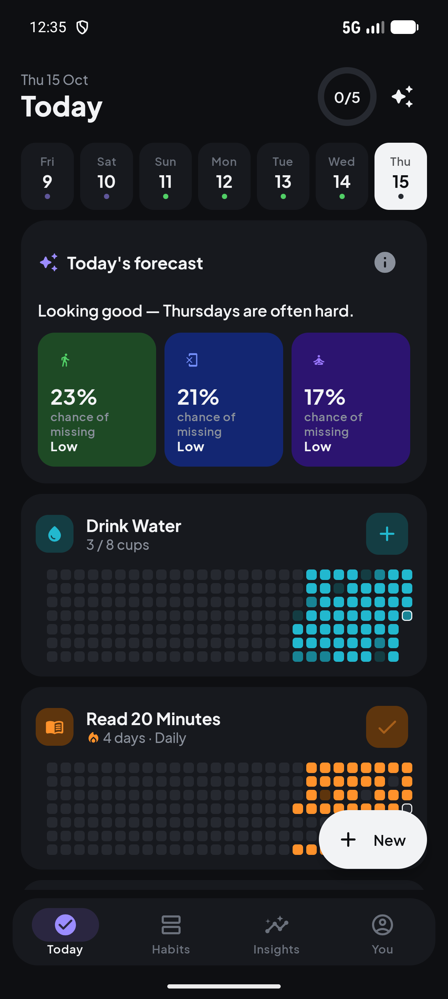
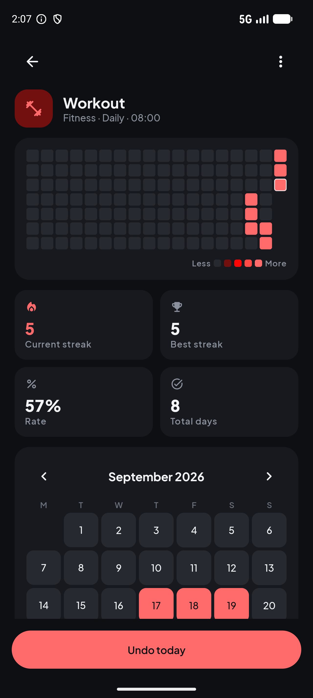
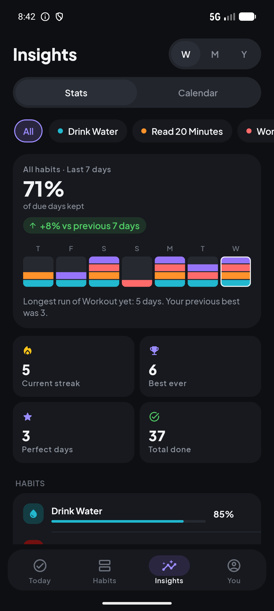
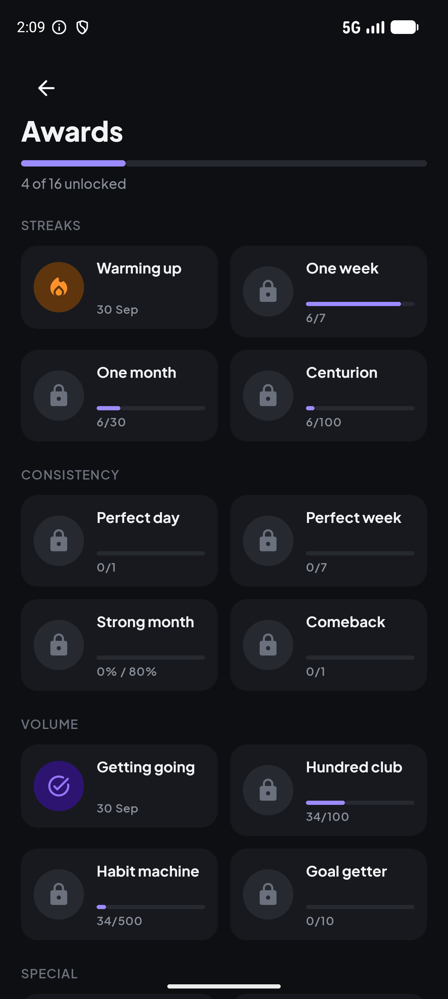
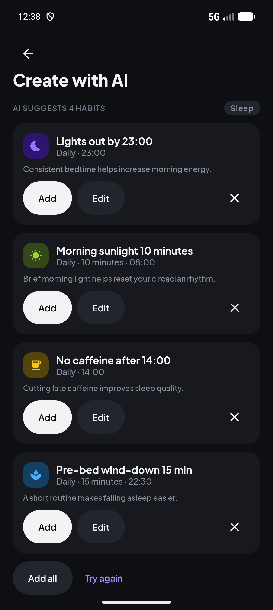
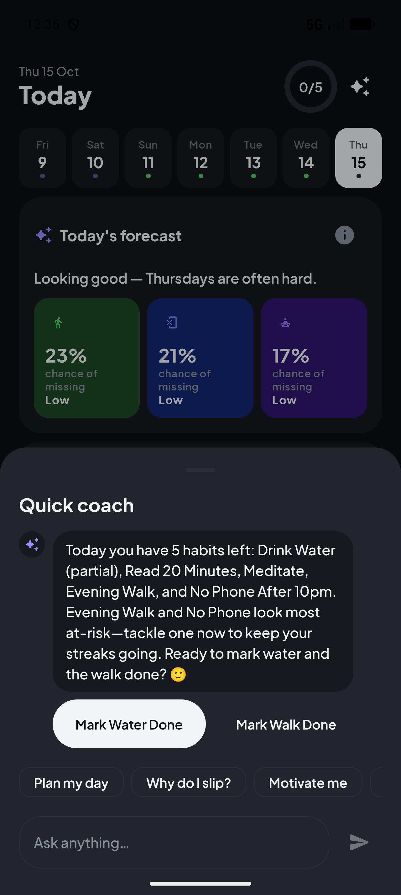
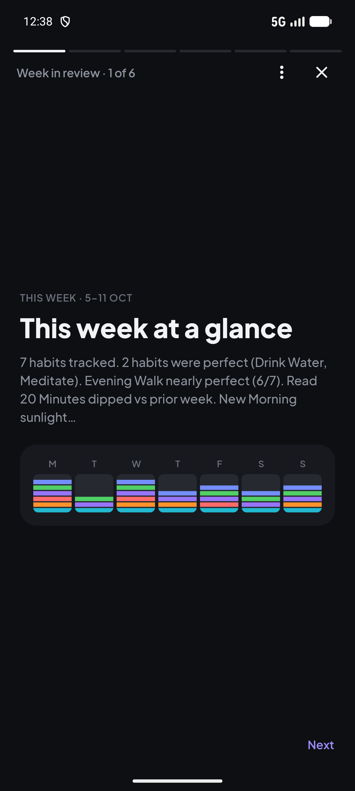
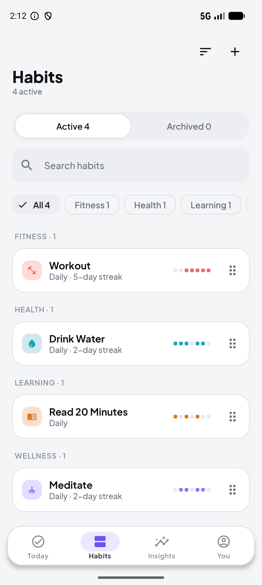

<div align="center">

# Habitly

**Small days add up.**

An Android habit tracker built with Kotlin and Jetpack Compose, with an on-device ML forecast
and an AI coach.


<a href="docs/demo/walkthrough.mp4"></a>

**[▶ Watch the full walkthrough (2 min)](docs/demo/walkthrough.mp4)** · **[▶ Watch the promo (47 s)](docs/demo/promo.mp4)**

</div>

---

## Contents

- [Demo videos](#demo-videos)
- [Features](#features)
- [Screenshots](#screenshots)
- [Tech stack](#tech-stack)
- [Architecture](#architecture)
- [Getting started](#getting-started)
- [Testing](#testing)
- [Project structure](#project-structure)
- [Privacy](#privacy)

## Demo videos

Both videos are screen recordings of the real app on a Pixel 10 Pro emulator. They include the live
AI features and have a narrated voice-over.

| Video | Length | What it covers |
| --- | --- | --- |
| [Full walkthrough](docs/demo/walkthrough.mp4) | 2:03 | Every main feature, one scene each, with captions and narration |
| [Promo](docs/demo/promo.mp4) | 0:47 | Fast cut of the highlights |

There are also music-only versions without narration: [walkthrough](docs/demo/walkthrough-music-only.mp4) ·
[promo](docs/demo/promo-music-only.mp4).

[](docs/demo/walkthrough.mp4)

## Features

### Tracking
- **Today screen**: a week strip, a progress ring and one card per habit, each with its own contribution grid.
  Tap to check a habit off. Counter habits (e.g. *8 cups of water*) fill up one tap at a time, and finished
  habits move to a **Done** section.
- **Flexible schedules**: daily, specific weekdays, or every N days, with optional reminders and daily goals.
- **Forgiving streaks**: mark a missed day as a *rest day* and your streak carries on.
- **Templates or from scratch**: pick a template or set the name, icon, colour, category and schedule yourself.
- **Habit list**: grouped by category, with filtering, search, sorting, drag-to-reorder and archiving.

### Insights
- **Habit detail**: a heatmap, current and best streak, completion rate, total days and a month calendar.
- **Insights**: week / month / year stats, a per-day completion chart, personal records and a calendar
  heatmap across all habits.
- **Awards**: 16 badges for streaks, consistency and volume.

### On-device ML forecast
- A **logistic-regression model trained on the phone** from your own check-ins predicts which habits you're
  likely to miss today, and why (e.g. *"Tuesdays are often hard"*).
- Features include day of week, recent and same-weekday completion, streak state, days since you last did it,
  how your other habits went recently, how new the habit is, and whether it has a reminder.
- The model is checked on held-out data with rolling-origin validation and compared with a simple baseline
  (AUC). It retrains every day with WorkManager. **Nothing leaves the device.**

### AI features (OpenAI)
- **Create with AI**: describe a goal in your own words or by voice, and get suggested habits you can add in one tap.
- **Quick coach**: a bottom-sheet chat that knows today's habits and risks, suggests validated one-tap
  actions (with undo) and can plan your day.
- **Week in review**: each week becomes a short story of your wins, weekday patterns and tips you can apply.
- **Consent first**: before any AI call, a sheet shows exactly what's sent and what isn't.

### Polish
- Light and dark themes, a custom typeface (Plus Jakarta Sans), and adaptive layouts for tablets.
- Reminder notifications, plus a *streak-at-risk* nudge.
- Export to CSV.

## Screenshots

| Today + forecast | Habit detail | Insights | Awards |
| :---: | :---: | :---: | :---: |
|  |  |  |  |

| Create with AI | Quick coach | Week in review | Light theme |
| :---: | :---: | :---: | :---: |
|  |  |  |  |

More screenshots are in [`docs/screenshots`](docs/screenshots).

## Tech stack

| Area | Tools |
| --- | --- |
| Language | Kotlin (JVM 17) |
| UI | Jetpack Compose, Material 3, Navigation Compose, window size classes |
| Data | Room (SQLite) + Kotlin Flow, DataStore preferences |
| Background work | WorkManager (daily model training, reminders) |
| ML | Hand-written logistic regression with feature extraction, rolling-origin CV and lambda search; no ML library |
| AI | OpenAI API with structured JSON output, called straight from the phone |
| Serialization | kotlinx.serialization |
| Testing | JUnit 4, Robolectric, kotlinx-coroutines-test |
| Min / target SDK | 26 / 35 |

## Architecture

The app uses MVVM with a unidirectional data flow: the UI observes `StateFlow` from ViewModels, and
ViewModels read from repositories backed by Room.

```
UI (Compose screens)  ──events──▶  ViewModels  ──▶  Repositories  ──▶  Room / DataStore
        ▲                              │
        └──────────── StateFlow ◀──────┘

ml/   FeatureExtractor → RiskModel (logistic regression) → Forecaster → Today's forecast strip
ai/   AiContextBuilder → OpenAiApi → validated AI actions → applied through the repository (with undo)
```

- **`domain/`**: pure Kotlin logic for streaks, schedules and stats. No Android code, so it's easy to test.
- **`ml/`**: the forecast pipeline. `ForecastTrainWorker` retrains once a day, and `ForecastRepository`
  makes sure only one training run happens at a time.
- **`ai/`**: builds the prompt context, calls OpenAI, and validates every action the AI proposes before
  it's applied. `DemoAiApi` gives canned responses for offline demos.

## Getting started

### Prerequisites
- Android Studio (AGP 8.5+), JDK 17
- An Android device or emulator on Android 8.0 (API 26) or later

### Build and run
```bash
git clone https://github.com/thesunnycode/habitly.git
cd habitly
./gradlew installDebug
```

The app works fully **without an API key**: tracking, insights, awards and the on-device forecast all run
offline. To turn on the AI features, add your own key to the git-ignored `local.properties`:

```properties
habitly.openaiKey=<your OpenAI API key>
# optional
habitly.openaiModel=gpt-5-mini
```

See [`docs/DEPLOY.md`](docs/DEPLOY.md) for the full guide, including spend limits and why an APK with
a key in it must never be shared.

> **Tip:** in a debug build, **You → Settings → Load demo data** adds six sample habits with eight weeks of
> history, so every screen (including the forecast) has something to show.

## Testing

```bash
./gradlew testDebugUnitTest
```

598 unit tests cover streak and schedule logic, statistics, the ML feature extractor and model, AI response
parsing and action validation, repositories and ViewModels.

## Project structure

```
app/src/main/java/com/habitly/app/
├── ai/            # OpenAI client, prompts, context builder, action validation
├── data/          # Room entities and DAOs, repositories, preferences, CSV export, demo seed data
├── domain/        # Streaks, schedules, stats (pure Kotlin)
├── ml/            # On-device risk forecast: features, model, training worker
├── reminder/      # Notification scheduling
└── ui/            # Compose screens: today, habits, insights, detail, coach, review, settings, …
docs/
├── demo/          # Demo videos, preview GIF and poster
├── screenshots/   # Screenshots grouped by date
├── specs/ plans/  # Design specs and implementation plans
└── DEPLOY.md      # Running the AI features on a real phone
proxy/             # Earlier Cloudflare Worker AI proxy (reference only, not used by the app)
```

## Privacy

- All habit data is stored **only on the device** (Room). Habitly has no backend.
- The forecast model is trained and run **on the device**.
- AI features run only after you agree. They send habit names, schedules, reminder times and
  done / rest / missed counts. **Your name and notes are never sent.**
